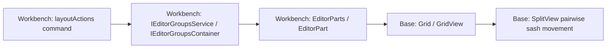

# Directional editor group resize design

## Request and current behavior

This local CSCI 360 Final Project Part 1 work addresses [microsoft/vscode#145890](https://github.com/microsoft/vscode/issues/145890), requested by `micimize`. The request is for keyboard commands that resize an editor pane toward a named side. Its three-column example requires the middle group to take width from the left group when resizing left, while preserving the right group. The issue also mentions a configurable increment; that is outside this implementation.

The existing Increase/Decrease Editor Width and Height commands in `layoutActions.ts` call `IWorkbenchLayoutService.resizePart`. The editor group grid's `Grid.resizeView` takes a target size but no side. A baseline Chromium reproduction on this branch constructed three 300 px columns in a 900 px grid and called `grid.resizeView(middle, { width: 360 })`; widths became `[300, 360, 240]`. This demonstrates why a target size alone cannot express “grow toward left.” The existing `GridView.resizeView` delegates to `BranchNode.resizeChild`, then `SplitView.resizeView`, whose relayout chooses which other views absorb the change.

Two upstream PRs already propose this issue: [#296358](https://github.com/microsoft/vscode/pull/296358) and [#337462](https://github.com/microsoft/vscode/pull/337462). Both were open when checked on 2026-11-22. This project is local course work and should not be presented as a novel upstream solution or sent upstream without resolving that overlap. Their code was inspected for design context; the implementation and tests on this branch must be reviewed as AI-assisted work.

## Acceptance criteria

- Four localized, discoverable commands, `workbench.action.resizeEditorLeft`, `Right`, `Up`, and `Down`, can be assigned user keybindings. The active group in the active editor part is the target.
- Each direction grows the active group's named edge by one existing 60 CSS px step, moving the nearest actual grid boundary on that side. The opposite edge remains in place. The neighboring subtree gives up the space; other siblings do not move.
- In `left | middle | right`, Left on middle changes left and middle widths and leaves right width unchanged. Right changes right and middle, leaving left unchanged. The vertical equivalents apply to Up and Down.
- A missing boundary is a no-op. Movement clamps to the minimum and maximum sizes of the two adjacent grid children, including nested subtrees; repeated commands at a limit are no-ops. The active group and focus do not change.
- Nested grids use the closest ancestor split with a boundary on the requested side. Multiple groups inside either adjacent subtree retain their internal proportions as allowed by grid layout.
- Existing resize commands keep their IDs and behavior. Tests cover the primitive and a registered-command path.

## Exclusions

No default keybindings, configurable increment, extension API, terminal-specific sizing, resizing across window boundaries, new UI, or changes to the existing width/height commands. The active group may belong to an auxiliary editor part; its own grid is resized in place. A user can bind the new command IDs in Keyboard Shortcuts. These exclusions keep the feature tied to the issue's boundary selection problem and avoid a new preference without clear requirements.

## Designs considered

**Chosen: move one selected grid sash.** Add a public `Grid.resizeViewInDirection(view, direction, amount)` operation and a corresponding grid-view operation. Walk from the leaf toward the root until a split on the requested axis has an adjacent child on that side. Move that split's selected sash. A SplitView operation clamps the delta against only the two children next to that sash, using the same internal size constraints as mouse sash movement. Expose the operation through `IEditorGroupsContainer`, `EditorPart`, and `EditorParts`; command handlers call it for the active group. This is more code across the base/workbench boundary, but the grid owns its topology and SplitView owns size constraints. It also makes the behavior testable below the command layer.

**Rejected: shrink the editor group found by `findGroup({ direction })`.** This is viable for two adjacent leaves and uses existing `setSize`, as in upstream PR #296358. It is a poor general fit: `findGroup` orders geometric neighbors by editor-group MRU and returns one leaf, while a grid boundary can separate a leaf from a nested subtree. `setSize` still asks generic relayout to choose the space recipient and does not promise preservation of other siblings. A visual neighbor is not necessarily the child adjacent to the sash that must move.

**Alternative: extend `Grid.resizeView` with an optional preferred side.** This avoids a separate public method but mixes a target-size API with a boundary movement operation, complicates its callers and backward compatibility, and still needs SplitView pairwise clamping. A distinct method gives the side-specific contract a clear name.

I do not assume the existing `Grid.resizeView` guarantees directional behavior: the baseline reproduction showed the opposite. The selected design's guarantee depends on the new pairwise SplitView operation and its tests, including nested and minimum-size cases.

## Placement and coupling

The existing [logical architecture](Logical-Architecture.md) and [diagram source](logical-architecture.mmd) place `src/vs/workbench` above `src/vs/base`. This feature follows that dependency direction:

Expected existing files are `src/vs/workbench/browser/actions/layoutActions.ts`, `src/vs/workbench/browser/parts/editor/editorPart.ts`, `editorParts.ts`, `src/vs/workbench/services/editor/common/editorGroupsService.ts`, `src/vs/base/browser/ui/grid/grid.ts`, `gridview.ts`, and `src/vs/base/browser/ui/splitview/splitview.ts`, plus matching tests and the test service stub. The public workbench service interface is the new command-to-layout contract. This does not reach into private grid fields from workbench code.

GRASP **Information Expert** puts grid ancestry lookup in GridView and size-limit enforcement in SplitView. **Controller** keeps the command handler small: it selects the active group and direction, then delegates. **Low Coupling** keeps command registration unaware of split topology. The new grid method is an explicit operation rather than an event-driven control flow.

## Security, compatibility, and review risk

The command accepts no file, workspace, network, or extension content. It operates on in-memory editor layout state under the existing command service. No new trust boundary, permission, persistence format, telemetry, or workspace trust behavior is introduced. Input is a fixed direction and fixed step from registered commands; the base operation should reject non-finite amounts defensively.

Existing command IDs and sizing methods remain unchanged. The new service method requires test implementations of the interface to be updated. Layout preferences and saved group topology are unchanged; resizing an active maximized group may need to restore normal layout before moving a boundary, consistent with current `GridView.resizeView`. The likely maintainer challenge is expanding the generic SplitView and Grid APIs for four workbench commands, especially given the two open upstream PRs. Tests must show the cross-layer contract earns that surface area.
