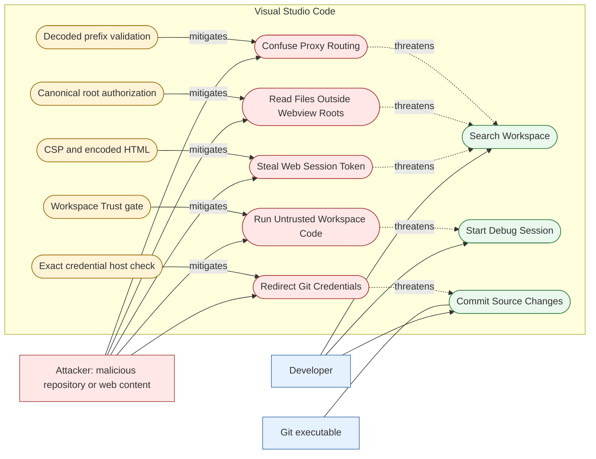
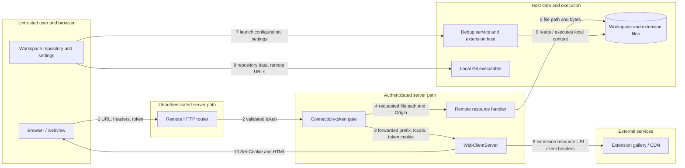

# Security Analysis — Visual Studio Code

**Scope:** This analysis is of the local `bolanosmanny/vscode` fork at `d1ac3dcdafb` before the A5 change. It is a code and public-disclosure review, not a test of any deployed VS Code server. The earlier use cases are [Search Workspace, Start Debug Session, and Commit Source Changes](https://github.com/bolanosmanny/vscode/blob/main/docs/requirements-and-use-cases.md). The diagrams below are embedded Mermaid; their editable source files are [a5-misuse-cases.mmd](https://github.com/bolanosmanny/vscode/blob/main/docs/a5-misuse-cases.mmd) and [a5-trust-boundaries.mmd](https://github.com/bolanosmanny/vscode/blob/main/docs/a5-trust-boundaries.mmd).

## Part 1 — Misuse case diagram



The attacker is outside the VS Code system boundary. The dashed, labeled arrows mean **threatens**; the solid, labeled arrows from controls mean **mitigates**. The credential case is about a malicious repository directing an otherwise normal Git operation to a lookalike host, as in [CVE-2026-47284](https://github.com/microsoft/vscode/security/advisories/GHSA-qcxw-jfff-cxpc).

## Part 2 — Two fully dressed misuse cases

### MC1: Steal Web Session Token

**Attacker and goal:** An attacker who can cause script to execute in the web workbench origin wants the remote server's connection token, so they can impersonate the developer's browser session. This is a conditional scenario; it assumes a separate same-origin script-injection foothold and does not claim the current workbench has one.

**Preconditions:** The developer uses the remote web workbench with a connection token; the browser stores the token cookie; and attacker-controlled script executes in that origin. In this checkout, `src/vs/server/node/webClientServer.ts` issues the cookie without `HttpOnly` at both the initial token redirect and later renewal because the browser client reads it for remote connection setup.

**Attack scenario:**

1. The developer opens a token-bearing remote workbench URL. The server validates the token and redirects to a clean URL while setting the connection-token cookie.
2. A separate same-origin injection causes attacker-controlled JavaScript to run in the workbench page.
3. The script reads `document.cookie` and extracts the connection token.
4. The script sends the token to an attacker-controlled destination.
5. The attacker presents the token to the remote server and requests resources as the developer's session.

**Intervention points:** At step 2, workbench template encoding and a nonce-based Content Security Policy can prevent many script injections (`renderWorkbenchTemplate` and `createWorkbenchContentSecurityPolicy` in `webClientServer.ts`). At step 3, a future design could use `HttpOnly` only after changing the web client so it no longer reads the token from `document.cookie` (`src/vs/workbench/browser/web.main.ts:327`). At step 5, the token gate in `remoteExtensionHostAgentServer.ts` must validate the token; rate limits, token rotation, and shorter lifetime would reduce use after theft.

**Consequence:** If the token is stolen, the attacker can act within that remote server session, including requesting the developer's remote resources. The developer loses confidentiality and control of that session. The current web client reads the cookie, so a cookie-only `HttpOnly` patch would break normal remote connections.

### MC2: Read Files Outside Webview Roots

**Attacker and goal:** An attacker who controls content rendered in a webview wants a remote workspace file outside the extension's declared `localResourceRoots`.

**Preconditions:** The developer opens attacker-influenced webview content while connected to a remote workspace. The webview can issue a crafted resource URI. The attack depends on a mismatch between path normalization during containment checking and file loading, the root cause reported in [CVE-2026-102229](https://github.com/microsoft/vscode/security/advisories/GHSA-89cr-6h4p-hpx9); this checkout is newer than the patched version, so this is a modeled misuse case, not a claim of an unfixed exploit here.

**Attack scenario:**

1. The developer opens the webview as part of inspecting workspace content.
2. The webview requests a remote resource with a specially formed path that appears inside an allowed root to one path interpretation.
3. VS Code checks whether the requested path lies under a webview resource root.
4. A downstream loader interprets the path differently and opens a file outside that root.
5. The file bytes are returned to the webview, where attacker-controlled content can read them.

**Intervention points:** At step 2, the resource handler can reject malformed or ambiguous paths. At step 3, the webview resource authorization layer must normalize both requested and allowed paths using the remote operating system's rules and authorize the exact path used at step 4. At step 4, the file loader can enforce the same authorized root as defense in depth.

**Consequence:** The webview obtains data the extension was not authorized to expose. The user loses confidentiality of remote workspace or host files. The historical fix normalizes both sides and loads the checked path; it does not remove the need to audit other path consumers.

## Part 3 — Trust boundary diagram

The boxes below represent separate trust zones. The numbered edges, including the return edge to the browser, are the crossing inventory. A local desktop session and a remote web server use different subsets of these paths; the diagram shows the project features relevant to the earlier use cases and this analysis.



| # | Trust change and data | Validation and owning component |
| --- | --- | --- |
| 1 | Browser → remote HTTP router: URL, headers, cookie/query token | `remoteExtensionHostAgentServer.ts` parses the URL and routes the request. Header provenance is not authenticated here. |
| 2 | Unauthenticated route → authenticated route: connection token | `requestHasValidConnectionToken` in `serverConnectionToken.ts` checks the query or cookie token; `remoteExtensionHostAgentServer.ts` rejects invalid tokens with 403 before resource and web routes. `/version` and `/delay-shutdown` are deliberately handled before this gate. |
| 3 | Browser values → `WebClientServer`: forwarded prefix, locale, token | Before A5, `isSafeBasePath` checked only raw syntax, accepting encoded separators and dot segments such as `/%2f%2fevil.com` and `/proxy/%2e%2e/admin`. A5 decodes and rejects ambiguous forms. `createNlsUrl` encodes the locale segment; `renderWorkbenchTemplate` HTML-attribute encodes substitutions. **Remaining finding:** no check establishes that `x-forwarded-prefix` came from a trusted proxy. |
| 4 | Browser → remote resource handler: `path`, `Origin` | Handler requires exactly one `path` and parses it as a file URI; `getRemoteResourceResponseHeaders` only grants CORS to the native workbench or configured web endpoint origin. **Finding:** this handler does not perform a per-resource webview-root authorization check. The connection token is its main access gate. |
| 5 | Remote resource handler → host filesystem: selected file path, bytes | `serveFile` checks existence and streams bytes. **Finding:** `serveFile` itself does not validate that the selected remote resource path is under an allowed workspace or extension root; callers must own that policy. |
| 6 | `WebClientServer` → extension gallery/CDN: URL and selected client headers | `_handleWebExtensionResource` compares the requested resource authority's parent domain with the configured resource template before `IRequestService.request`. This is a domain check; response body trust is still that of external content. |
| 7 | Workspace repository → debug service/extension host: launch settings and executable commands | `DebugService.startDebugging` requests workspace trust before executing workspace code. Configuration resolution and debugger extensions run after this gate. This is a high-value boundary because a missed entry point can execute untrusted code. |
| 8 | Repository → Git executable: paths, remotes, commit inputs | Git handles repository syntax and command execution; the built-in Git extension constructs argv. Credential helpers must separately validate the exact destination host before supplying credentials. |
| 9 | Debug/extension host → host filesystem: program and workspace data | OS file permissions and VS Code workspace trust govern this access; there is no general per-file authorization for a trusted debug session. |
| 10 | Web server → browser: HTML and connection-token cookie | CSP with per-request nonce governs script execution. The browser client currently reads the bearer token from the cookie to establish its remote connection, so the cookie cannot be switched to `HttpOnly` without a protocol change. This code sets a seven-day cookie lifetime. |

**Trust that should be verified:** At crossing 3, `x-forwarded-prefix` is treated as the proxy's path hint based on syntax alone. A direct client can supply a syntactically valid prefix. If an installation assumes only its proxy controls that header, attacker-selected path prefixes could be reflected into links and redirects, confusing navigation or downstream routing. The structural fix belongs at the HTTP edge: strip this header from untrusted clients or accept it only when the immediate peer is an explicitly configured trusted proxy. The A5 decoded-path check is a smaller slice and does not establish header provenance.

## Part 4 — Threat model

Likelihood is for a developer who handles untrusted repositories or webview content, with a remote web server where applicable. It is an architectural judgment, not a measurement of attacks against this fork.

| Risk | Asset; STRIDE; OWASP Top 10 (2021) | Likelihood / impact and reason | Architectural mitigation and owner |
| --- | --- | --- | --- |
| R1: Connection-token disclosure after a same-origin script foothold (MC1) | Remote connection token and session; **information disclosure / spoofing**; **A07 Identification and Authentication Failures** | **Medium / High.** A separate injection is required, but the seven-day bearer cookie is currently read by page JavaScript, and theft grants session access. | `web.main.ts` and the remote connection protocol must stop requiring JavaScript to read the token; the server can then authenticate browser-sent cookies with origin/CSRF checks and set `HttpOnly` in `WebClientServer`. This belongs at both ends of the authentication contract, not just the cookie serializer. Keep CSP and output encoding at the HTML response layer. |
| R2: Resource-root interpretation mismatch (MC2) | Remote workspace files; **information disclosure**; **A01 Broken Access Control** | **Low / High** for this patched checkout: an attacker needs a webview and a new mismatch; the historical bug proves the boundary is subtle. A successful mismatch exposes files beyond the declared roots. | The webview resource authorization layer must canonicalize both candidate and roots with remote OS rules, then hand the identical authorized path to the loader. The file service must not re-interpret unchecked input. `serveFile` is too late to reconstruct the webview's allowed roots by itself. |
| R3: Ambiguous proxy prefix changes navigation or routing | Generated web paths and redirects; **tampering / spoofing**; **A05 Security Misconfiguration** | **Medium / Medium** in a remote web deployment: a direct client can set `x-forwarded-prefix`, and the pre-A5 check accepted encoded path separators and dot segments. Impact depends on proxy behavior and deployment routing; the code review does not establish an exploit against a live deployment. | `isSafeBasePath` in `src/vs/server/node/webClientServer.ts` must decode once and reject ambiguous separators, dot segments, malformed escapes, and control characters before composing a redirect or workbench configuration. The HTTP edge must also bind `x-forwarded-prefix` to a trusted proxy to close the provenance issue. |

The first small change is R3's decoded-prefix check at the server response layer because it is centrally owned and can be validated without changing the browser/server authentication contract. The higher-impact R1 token redesign remains a larger architectural task, and R2 needs continued review of resource loaders.

## Part 5 — Security bug history

I searched the public VS Code [security advisory list](https://github.com/microsoft/vscode/security/advisories) and the linked issues. These are actual reported and fixed vulnerabilities; both patched versions predate this checkout's `1.146.0` development version.

| Report and fix | Architectural root cause | Structural or narrow? Reappearance risk | OWASP |
| --- | --- | --- | --- |
| [CVE-2026-102229 / GHSA-89cr-6h4p-hpx9](https://github.com/microsoft/vscode/security/advisories/GHSA-89cr-6h4p-hpx9), [issue #341379](https://github.com/microsoft/vscode/issues/341379), fixed in 1.141.1 by [`b0240f4`](https://github.com/microsoft/vscode/commit/b0240f4). | The remote webview root check and the later file load used inconsistent path normalization. The authorization decision did not bind to the exact path used for I/O. | **Structural within this path:** normalize requested path and roots using remote OS rules and load the path checked; deny when remote OS is unknown. Similar check/use mismatches can reappear in other URI or file loaders. | **A01 Broken Access Control.** |
| [CVE-2026-78462 / GHSA-2cmq-rv52-5rf6](https://github.com/microsoft/vscode/security/advisories/GHSA-2cmq-rv52-5rf6), [issue #335119](https://github.com/microsoft/vscode/issues/335119), fixed in 1.136.2 by [`4321a67`](https://github.com/microsoft/vscode/commit/4321a67). | An untrusted repository's `.vscode/settings.json` could supply remote agent host addresses and persisted local-file permission grants. A lower-trust configuration scope selected a privileged connection and its access policy. | **Structural for these settings:** read them only from global configuration and mark them restricted. The same class can recur if another privileged setting or consumer accepts workspace scope without a trust check. | **A01 Broken Access Control** (with A05 Security Misconfiguration as a contributing design issue). |

## Part 6 — Supply chain and dependency analysis

**SBOM and counts.** I ran Syft 1.57.0 against the project's root pnpm workspace lockfile: `syft file:pnpm-lock.yaml -o cyclonedx-json=docs/sbom.json`. The generated [CycloneDX SBOM](https://github.com/bolanosmanny/vscode/blob/main/docs/sbom.json) has **1,532 component entries**. The root `package.json` declares **177 direct dependency entries** (70 runtime, 106 development, one optional). The gap is the transitive dependency tree resolved by pnpm for the root and workspace importers; the SBOM also includes development and optional packages, so it is not a shipped-runtime-only inventory. This lockfile-based SBOM does not inventory binaries fetched outside pnpm.

**Known vulnerability and reachability.** `COREPACK_HOME=/private/tmp/a5-corepack corepack pnpm audit --json` reported 42 findings (4 low, 23 moderate, 15 high) in the root lockfile. One is [`minimatch` CVE-2026-118764 / GHSA-g3hv-75wg-m249](https://github.com/advisories/GHSA-g3hv-75wg-m249): the root `pnpm-lock.yaml` and SBOM include **10.2.6**; the GitHub Advisory Database lists **`>=7.0.0, <11.0.1`** as affected and **11.0.1** as patched. The [maintainer advisory](https://github.com/isaacs/minimatch/security/advisories/GHSA-g3hv-75wg-m249) specifically names 10.2.6. The mechanism is availability loss from CPU and memory amplification when an attacker controls a glob passed with `optimizationLevel >= 2`; confidentiality and integrity are not the stated impact.

The lockfile routes this 10.2.6 copy into development packages including `@eslint/config-array`, `@typescript-eslint/typescript-estree`, ESLint, nodemon, and `test-exclude` (`pnpm-lock.yaml` snapshots near lines 7243, 7990, 9877, 11760, and 13066). I found **no project-source call path** that passes `optimizationLevel >= 2` to that copy, and no remote request path to these development tools. Therefore the advisory is a real vulnerable package/version in the dependency graph, but the described trigger is **not shown reachable from VS Code's runtime or this code's calls**. It remains a build-tool risk if tooling later accepts hostile glob patterns with that option. The broader database range is disputed for older versions because the described optimizer is absent there; this finding relies on 10.2.6, which both database and maintainer name. See the [range discussion](https://github.com/github/advisory-database/issues/10811).

**Provenance.** The checked-in Azure pipelines contain macOS code-signing/notarization steps (`build/azure-pipelines/darwin/product-build-darwin-universal.yml`) and Windows signing (`build/azure-pipelines/win32/product-build-win32.yml`); the [official download page](https://code.visualstudio.com/Download) publishes SHA-256 hashes for artifacts. I did not find a release step in this checkout that publishes a public SLSA/in-toto attestation, Sigstore bundle, or commit-bound provenance for downloaded VS Code binaries. Code signing authenticates a publisher and a hash checks bytes against the published value; neither alone proves that a downloaded binary was built from a named Git commit. Thus a user could check the download hash and platform signature, but **could not independently prove the claimed source commit from the evidence found here**. This is a scoped finding about the public files and release information inspected, not a claim about Microsoft's private build systems.

**OWASP mapping and recommendation.** The affected `minimatch` version and 42 audit findings are **A06 Vulnerable and Outdated Components**. The missing public source-to-artifact proof is **A08 Software and Data Integrity Failures**. Add a release-pipeline step after signing that publishes a signed in-toto/SLSA provenance statement binding each released artifact digest to the exact Git commit and builder identity, with verification instructions on the download page. This costs maintainers release-pipeline integration, keyless signing or signer management, storage/publication of attestations, and ongoing verification and incident handling if a build or signature fails.

## Part 7 — Implement one control

**Control:** Decode and validate a browser-supplied `x-forwarded-prefix` before using it as a base path. The check rejects encoded slashes/backslashes, decoded dot segments, a decoded second `%` (which could be decoded again by a downstream hop), query/fragment delimiters, control characters, and malformed escapes. This is working server code at **crossing 3**, defending **R3 / Confuse Proxy Routing**. `WebClientServer` owns the check because it uses the header to create redirect and workbench paths.

**Before (base commit `d1ac3dcdafb`):** `src/vs/server/node/webClientServer.ts:130–134` checked only the raw string, so `/%2f%2fevil.com` and `/proxy/%2e%2e/admin` were accepted:

```ts
return basePath.startsWith('/')
    && !basePath.startsWith('//')
    && !/[?#\\]|[\u0000-\u001F\u007F]/.test(basePath);
```

**After ([A5-Fix commit](https://github.com/bolanosmanny/vscode/commit/11855e8888a0648d116922a6bbd5b2af7bef0d90)):** `src/vs/server/node/webClientServer.ts:130–143` validates both the raw path and the decoded path:

```ts
if (!basePath.startsWith('/') || basePath.startsWith('//') || /%(?:2f|5c)/i.test(basePath)) {
    return false;
}
try {
    const decodedPath = decodeURIComponent(basePath);
    return !decodedPath.startsWith('//')
        && !/[?#\\%]|[\u0000-\u001F\u007F]/.test(decodedPath)
        && !/(?:^|\/)\.{1,2}(?:\/|$)/.test(decodedPath);
} catch {
    return false;
}
```

The focused cases are in `src/vs/server/test/node/webClientServer.test.ts`: ordinary and space-encoded prefixes still pass, while encoded separators, traversal segments, repeated encoding, and malformed escapes fail. **Validation:** `corepack pnpm run build-fast --client-only` completed successfully; `node test/unit/node/index.js --run src/vs/server/test/node/webClientServer.test.ts` reported **7 passing**; targeted ESLint checked both changed files with no errors. This control does **not** prove the header came from a trusted proxy, and it does not solve all possible proxy normalization differences. The complete fix requires the HTTP edge or reverse proxy to strip client-supplied forwarded headers and accept the configured prefix only from a trusted immediate peer.

**Commit link:** [A5-Fix commit](https://github.com/bolanosmanny/vscode/commit/11855e8888a0648d116922a6bbd5b2af7bef0d90).

## Part 8 — Two-minute class walkthrough

1. Show the misuse diagram. Walk through MC2: a webview path is checked under one interpretation and loaded under another, allowing a read outside the webview roots.
2. Point to crossing 3 on the trust diagram: `WebClientServer` accepts a browser-supplied proxy prefix. The first small mitigation is decoded-path validation there.
3. Name the dependency risk: `minimatch` 10.2.6 is in the lockfile and has CVE-2026-118764, an availability issue. I found no project call with the required `optimizationLevel >= 2`, so the described trigger is not demonstrated reachable from runtime.
4. Show the before/after code above and explain that encoded traversal and separator forms are now rejected, while trusted-proxy provenance remains open.

## Submission steps left to the student

Review the analysis and render the Mermaid blocks in the GitHub wiki. The code and test are in the linked `A5-Fix` commit. Commit the A5 docs and SBOM with `A5: Add security analysis and misuse cases`, paste this page into the fork wiki as **Security Analysis**, and submit that wiki URL on OAKS. No upstream pull request is needed.
